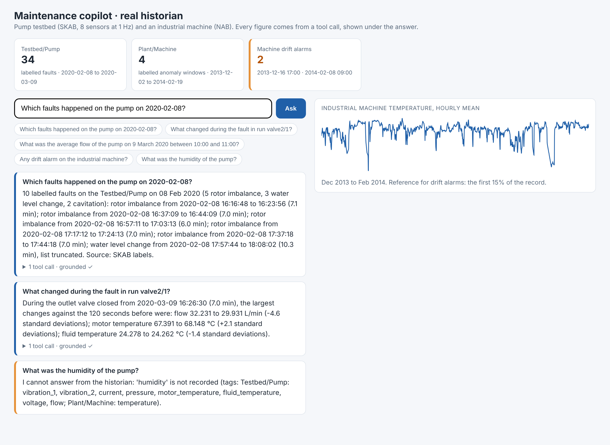
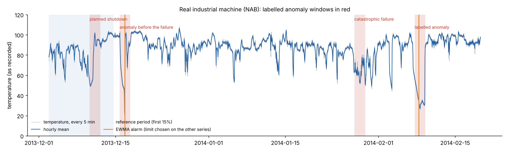

# Maintenance copilot on a real historian: answers from sensor data, every figure traceable

[](https://github.com/kawtar-bellamine/industrial-copilot/actions/workflows/tests.yml)

Engineers ask simple questions of their process data: *which faults happened yesterday, what changed when the valve
closed, is the machine drifting?* This copilot answers them from the historian only. It calls tools (sensor
statistics, the event log, the signature of a fault, drift alarms), writes the answer from their outputs, **shows the
tool calls under the answer**, and **refuses** when the data does not hold the answer. A grounding check releases an
answer only if every number in it comes from a tool output: the guard that keeps a language model honest when one
writes the answer.

**The historian is built from two real, labelled data sets** ([`copilot/historian.py`](copilot/historian.py)),
fetched at pinned commits and stored in SQLite with ISA-95 style tag paths:

- **Testbed/Pump**: [SKAB](https://github.com/waico/SKAB) (GPL-3.0), a water loop with a centrifugal pump, 8 sensors
  at 1 Hz (vibration, motor current and voltage, pressure, flow, motor and fluid temperatures), 35 runs recorded in
  February and March 2020, 34 labelled faults (valves closed, rotor imbalance, leaks, water level, cavitation). The
  labels are the event log.
- **Plant/Machine**: the temperature of an internal component of a large industrial machine, every 5 minutes from
  December 2013 to February 2014, with 4 labelled anomaly windows including a planned shutdown and a catastrophic
  failure ([NAB](https://github.com/numenta/NAB), realKnownCause, AGPL-3.0).



## How it works

- **Tools** ([`copilot/tools.py`](copilot/tools.py)): `tag_stats`, `events` (the event log, by type), `fault_effect`
  (mean of every sensor during a fault against the two minutes before, ranked in standard deviations) and `drifts`
  (EWMA on hourly means against a reference period). Each returns plain data and the period it covers; unknown
  assets or tags, dates outside the history and periods when an asset was not recording raise a "no data" answer.
- **Assistant** ([`copilot/assistant.py`](copilot/assistant.py)): assets and their aliases, tags (*flow rate,
  motor temperature, vibration*), periods (*on 9 March 2020 between 10:00 and 11:00, in January 2014, during run
  valve2/1*), intents; forecasts are refused (*the copilot reports, it does not predict*).
- **Grounding check**: every number in the answer must appear in a tool output, otherwise the answer is withheld.
  An OpenAI-compatible model can reword the answers (`LLM_BASE_URL`, `LLM_API_KEY`, `LLM_MODEL`); its text goes
  through the same check.
- **Interface**: FastAPI and React: labelled events per asset, drift alarms, the machine temperature trend.

## Findings

1. **56 of 56 test questions answered correctly or refused correctly**, checked against figures recomputed from the
   raw CSV files by separate code: 23 sensor averages over time windows on the pump, 8 machine temperature values,
   3 fault counts per day, 8 fault signatures (*the sensor that changed most*), 2 questions on the machine's events,
   and 12 questions it must refuse (unknown asset, sensor not recorded, date outside the history, the pump asked
   about in 2013, forecasts, off-topic).

2. **The grounding check caught every invented figure.** One number was changed in 44 correct answers, as a language
   model might do; the check withheld all 44. It also caught the copilot itself: the first version counted faults
   by type in the text, not in a tool, and its own answers were withheld until the counts moved into the tool.

3. **Real data has quirks the copilot must state.** Five SKAB runs overlap in time (the testbed's clock): 1,290
   seconds are recorded twice with different values. The historian keeps the run that started first and says so;
   the faults of both runs stay in the event log.

4. **A fault has a readable signature.** Closing the outlet valve shows first in the flow (32.2 to 29.9 L/min,
   -4.6 standard deviations), then in the motor temperature. Ranking sensors against the minutes before the fault
   gives the engineer the first hint of a diagnosis, with numbers that trace back to the historian.

5. **Drift alarms on real labels: few windows, few false alarms.** On the 7 real series of NAB's realKnownCause set
   (18 labelled windows after the reference period), settings chosen by leaving one series out:

   | Detector (hourly means, reference = first 15% of the series) | Windows detected | False alarms per 30 days |
   |---|---|---|
   | Fixed threshold | 4/18 | 0.53 |
   | **EWMA** | **6/18** | **0.24** |
   | CUSUM | 3/18 | 2.01 |

   On the industrial machine, EWMA flags the anomaly that, according to NAB, led to the failure, **six weeks before
   the catastrophic failure**, but not the failure itself: the reference period contains the planned shutdown,
   which widens the normal range. Choosing the reference period is a decision for the maintenance team, not a
   default.

   

6. **Rule-based understanding is safe but narrow.** On 10 questions written freely, it answered 2 correctly, 1
   partially, and refused 7 (*"How did the pump behave when the outlet valve was closed?"*, *"Which run had the
   strongest vibration?"*). It never gave a wrong figure. That is where a language model as planner adds value,
   with the same tools and the same grounding check: [`results/freeform_questions.json`](results/freeform_questions.json).

All numbers: [`results/metrics.json`](results/metrics.json).

## Run it

```bash
pip install -r requirements.txt
python -m copilot.historian          # fetch SKAB and NAB at pinned commits, build the historian
python -m copilot.evaluate           # questions, refusals, grounding check, drift detectors on NAB
cd web && npm install && npx vite build && cd ..
uvicorn app.api:app --port 8000      # interface on http://localhost:8000
pytest -q
```

## Limits and next steps

- An LLM planner for questions spanning several tools (comparisons, rankings, filters by fault type), evaluated on
  the same questions with the same grounding check.
- A plant historian would be read through OPC UA or MQTT (Unified Namespace) into the same tools.
- Drift detection uses a single reference period; production regimes and planned stops need to be excluded from it.

Kawtar Bellamine, 2026.
